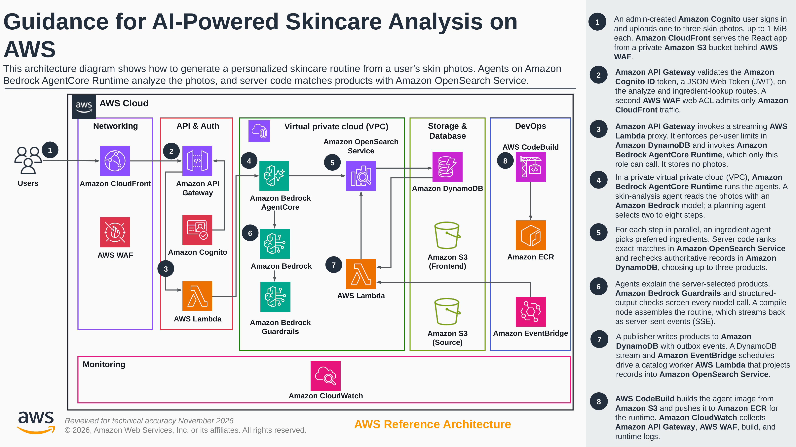

# Guidance for AI-Powered Skincare Analysis on AWS

## Table of Contents

1. [Overview](#overview)
    - [Architecture](#architecture)
    - [How it works](#how-it-works)
    - [Cost](#cost)
    - [Cost Breakdown](#cost-breakdown)
2. [Prerequisites](#prerequisites)
    - [Operating System](#operating-system)
    - [Third-party Tools](#third-party-tools)
    - [AWS Account Requirements](#aws-account-requirements)
    - [Supported Regions](#supported-regions)
3. [Deployment Steps](#deployment-steps)
4. [Deployment Validation](#deployment-validation)
5. [Running the Guidance](#running-the-guidance)
6. [Next Steps](#next-steps)
7. [Cleanup](#cleanup)
8. [FAQ, Known Issues, Additional Considerations, and Limitations](#faq-known-issues-additional-considerations-and-limitations)
9. [Revisions](#revisions)
10. [Notices](#notices)
11. [Authors](#authors)

## Overview

This Guidance demonstrates how to build a personalized skincare analysis application using a multi-agent AI architecture on AWS. A user submits up to three skin photos through a secure web interface. Specialized AI agents analyze the photos and plan a routine; server code selects products from the catalog while the application streams progress to the user.

The multi-agent system is orchestrated as a directed graph using the [Strands Agents SDK](https://github.com/strands-agents/sdk-python) and runs on Amazon Bedrock AgentCore Runtime. Specialized agents handle skin analysis, routine planning, ingredient selection, and explanations. Exact ingredient matching uses a private OpenSearch index, with DynamoDB as the authoritative catalog. Progress and intermediate results stream to the frontend via Server-Sent Events (SSE).

**Product search uses no embeddings or semantic similarity.**

### Architecture



[View the reference architecture at full resolution](assets/images/architecture.png).

The reference image predates private indexed search and its publication pipeline;
the flow below describes the current implementation.

### How it works

1. **Web application.** The user signs in and submits up to three skin photos and optional ingredient constraints. **Amazon CloudFront** serves the React application from a private **Amazon S3** bucket, with **AWS WAF** protecting the web and API paths.
2. **Authentication.** **Amazon Cognito** authenticates administrator-created users. **Amazon API Gateway** validates the Cognito ID token on each analysis request.
3. **Controlled runtime access.** API Gateway invokes a streaming **AWS Lambda** proxy. The proxy checks the authenticated identity, enforces per-user usage limits and active-analysis leases in **Amazon DynamoDB**, and invokes **Amazon Bedrock AgentCore Runtime** with IAM credentials.
4. **Analysis and planning.** AgentCore runs the agents in isolated sessions. A skin-analysis agent uses an **Amazon Bedrock** multimodal model to produce a structured profile. A planning agent chooses 2–8 routine steps from the available catalog categories.
5. **Product selection.** Step-specific chains run in parallel. Each selects preferred ingredient IDs, queries private **Amazon OpenSearch Service**, ranks exact ingredient matches and enforces explicit must-haves, exclusions and price limits. Code verifies canonical DynamoDB records and selects up to three products per step; models explain that fixed list. **Amazon Bedrock Guardrails** screen model calls. Separate catalog workers publish, reconcile and maintain the index.
6. **Build and monitoring.** **AWS CodeBuild** builds the agent image from source in S3 and pushes it to **Amazon ECR** for the runtime. **Amazon CloudWatch** supports API, WAF, build, runtime and catalog observability.
7. **Assembly and streaming.** Code revalidates selected products and assembles the routine in its planned order, including explicit no-match steps. Progress and results stream back as SSE through Lambda, API Gateway, and CloudFront to the browser.

The short [architecture guide](docs/architecture.md) describes the search rules and catalog boundaries.

### Cost

You are responsible for the cost of the AWS services used while running this
Guidance. As of October 2026, the cost for running this Guidance with the default
settings in the US East (N. Virginia) (`us-east-1`) Region is approximately
**$368.34 per month** in base charges, plus the usage charges below.

Estimates are for one environment, using **730 hours/month**, in USD before taxes,
discounts and credits. Free-tier allowances are shared with other eligible account
usage. We recommend creating a Budget through AWS Cost Explorer to help manage
costs. Prices are subject to change. For full details, refer to the pricing webpage
for each AWS service used in this Guidance.

### Cost Breakdown

**Base charges**

| AWS service | Default configuration | Monthly cost [USD] |
| --- | --- | ---: |
| [Amazon OpenSearch Service][cost-opensearch] — data nodes | 2 × `r6g.large.search` × 730 hours × $0.167/hour | $243.82 |
| [Amazon OpenSearch Service][cost-opensearch] — gp3 storage | 2 × 30 GiB × $0.122/GB-month | $7.32 |
| [AWS PrivateLink][cost-privatelink] — interface endpoints | 7 services × 2 Availability Zones × 730 hours × $0.01/hour | $102.20 |
| [AWS WAF][cost-waf] — ACLs and rules | 2 web ACLs + 2 custom rules + 3 managed rule-group associations | $15.00 |
| **Base subtotal** | **Excludes usage charges below** | **$368.34** |

**Usage charges**

| AWS service | Stack usage | Unit pricing [USD] |
| --- | --- | --- |
| [Amazon Bedrock — Claude Sonnet 5.5][cost-models] | Skin analysis | Global standard inference: $2/million input tokens; $10/million output tokens |
| [Amazon Bedrock — Claude Haiku 5.5][cost-models] | Planning, ingredient selection and product explanations | Global standard inference: $0.10/million input tokens; $0.50/million output tokens |
| [Amazon Bedrock Guardrails][cost-guardrails] | Content, topic and sensitive-information filters | Per 1,000 text units metered by each filter: $0.15 content; $0.15 topics; $0.10 sensitive information |
| [Amazon Bedrock AgentCore Runtime][cost-agentcore] | Agent sessions | V1: $0.0895/vCPU-hour + $0.00945/GB-hour; memory includes idle session time |
| [AWS Lambda][cost-lambda] — API proxy | 256 MB ARM streaming function | $0.0000133334/GB-second + $0.20/million requests; streaming-data charges may apply |
| [AWS Lambda][cost-lambda] — catalog jobs | Three 512 MB x86 functions; 744,600 scheduled calls/month | $0.0000166667/GB-second + $0.20/million requests; maintenance compute alone ≈ $16.43/month at 45 seconds/call, before free tier |
| [Amazon DynamoDB][cost-dynamodb] | Five tables, catalog operations and point-in-time recovery (PITR) | $0.125/million read units; $0.625/million write units; $0.25/GB-month storage beyond the available 25 GB allowance; $0.20/GB-month PITR |
| [Amazon CloudWatch][cost-cloudwatch] | Eight alarms, dashboard, metrics, logs and traces | $0.10/standard alarm-month; $0.30/custom metric-month; $0.50/GB log ingestion; $0.03/GB-month log retention; dashboard and traces extra |
| [AWS WAF][cost-waf] — requests | CloudFront and API inspection | $0.60/million requests per web ACL; both layers are metered |
| [Amazon API Gateway][cost-apigateway] | REST API and streaming responses | $3.50/million billable requests; streaming billed in 10 MB increments, minimum one request |
| [Amazon CloudFront][cost-cloudfront] | Frontend/API delivery and path-rewrite function | Available monthly allowance: 1 TB transfer, 10 million HTTP(S) requests and 2 million Function calls; regional rates thereafter |
| [Amazon Cognito][cost-cognito] | Direct user sign-in | Available Lite/Essentials allowance: 10,000 monthly active users; tier rates thereafter |
| [AWS PrivateLink][cost-privatelink] — data | Interface endpoint traffic | $0.01/GB for the first 1 PB; applicable data transfer extra |
| [Amazon S3][cost-s3] | Assets, source, logs, versions and Terraform state | Standard: from $0.023/GB-month; $0.005/1,000 PUT-class requests; $0.0004/1,000 GET requests; other storage classes and transitions extra |
| [Amazon ECR][cost-ecr] | Retained container images | $0.10/GB-month; applicable transfer extra |
| [AWS CodeBuild][cost-codebuild] | ARM large image builds | $0.015/build minute |

Usage depends on model tokens, session duration, catalog activity and retained
data. Background jobs incur charges even without analyses. Runtime rates assume
[AgentCore V1][cost-platform] with the default [900-second idle timeout][cost-session-lifetime].
Apply shared free-tier allowances and applicable data transfer charges when
estimating your deployment.

[cost-opensearch]: https://pricing.us-east-1.amazonaws.com/offers/v1.0/aws/AmazonES/20261026173153/us-east-1/index.json
[cost-privatelink]: https://aws.amazon.com/privatelink/pricing/
[cost-waf]: https://aws.amazon.com/waf/pricing/
[cost-models]: https://pricing.us-east-1.amazonaws.com/offers/v1.0/aws/AmazonBedrockFoundationModels/20261012084008/us-east-1/index.json
[cost-guardrails]: https://aws.amazon.com/bedrock/pricing/
[cost-agentcore]: https://aws.amazon.com/bedrock/agentcore/pricing/
[cost-lambda]: https://aws.amazon.com/lambda/pricing/
[cost-dynamodb]: https://aws.amazon.com/dynamodb/pricing/on-demand/
[cost-cloudwatch]: https://aws.amazon.com/cloudwatch/pricing/
[cost-apigateway]: https://aws.amazon.com/api-gateway/pricing/
[cost-cloudfront]: https://aws.amazon.com/cloudfront/pricing/pay-as-you-go/
[cost-cognito]: https://aws.amazon.com/cognito/pricing/
[cost-s3]: https://aws.amazon.com/s3/pricing/
[cost-ecr]: https://aws.amazon.com/ecr/pricing/
[cost-codebuild]: https://aws.amazon.com/codebuild/pricing/
[cost-platform]: https://docs.aws.amazon.com/bedrock-agentcore/latest/devguide/runtime-how-it-works.html#runtime-platform-versions
[cost-session-lifetime]: https://docs.aws.amazon.com/bedrock-agentcore/latest/devguide/runtime-lifecycle-settings.html

## Prerequisites

### Operating System

These deployment instructions are optimized for **macOS** or **Amazon Linux 2023 / Ubuntu 22.04+**. Deployment on Windows requires WSL2 (Windows Subsystem for Linux).

### Third-party Tools

| Tool | Minimum Version | Purpose | Installation |
| --- | --- | --- | --- |
| Node.js | 24.x (LTS) | Frontend build toolchain | [nodejs.org](https://nodejs.org/) |
| Python | 3.11+ (3.12 tested) | Agents and local utilities | [python.org](https://www.python.org/downloads/) |
| uv | 0.10.10 (tested) | Python package manager | [docs.astral.sh/uv](https://docs.astral.sh/uv/getting-started/installation/) |
| Terraform | 1.5 | Infrastructure provisioning | [hashicorp.com](https://developer.hashicorp.com/terraform/downloads) |
| AWS CLI | 2.x | AWS service interaction | [aws.amazon.com/cli](https://aws.amazon.com/cli/) |

### AWS Account Requirements

- An AWS account with permissions to create and manage: IAM roles/policies, Amazon Bedrock, Amazon Bedrock AgentCore, Amazon DynamoDB, Amazon S3, Amazon CloudFront, AWS WAF, Amazon Cognito, Amazon API Gateway, Amazon ECR, AWS CodeBuild, Amazon OpenSearch Service, Lambda, VPC endpoints, Amazon CloudWatch, and EventBridge. Use a dedicated test account for the first deployment.
- Account access to the following Amazon Bedrock models from your deployment region:
    - **Anthropic Claude Sonnet 5.5** (cross-region inference profile: `global.anthropic.claude-sonnet-5-5`)
    - **Anthropic Claude Haiku 5.5** (cross-region inference profile: `global.anthropic.claude-haiku-5-5`)

  Follow the current [Bedrock model-access prerequisites](https://docs.aws.amazon.com/bedrock/latest/userguide/model-access.html), including Anthropic's first-time-use form and any required AWS Marketplace subscription permissions. Complete account activation using an authorized administrator before testing the restricted runtime role.

  Model settings are defined in `config.py`; the Terraform model allowlist in
  `terraform/iam.tf` must remain consistent with those settings.

### Supported Regions

Choose the deployment region through `AWS_REGION` or your AWS CLI profile;
`us-east-1` is the default. Terraform does not impose a region allowlist.
The selected region must support the required AWS services, the configured
Bedrock model profiles and your account's quotas.

Terraform discovers enabled standard Availability Zones and selects the first
two sorted by zone ID. Check that this pair is listed in
[AgentCore's supported Availability Zones](https://docs.aws.amazon.com/bedrock-agentcore/latest/devguide/agentcore-vpc.html).
If necessary, set `search_availability_zone_ids` in `terraform/terraform.tfvars`
to an ordered pair of compatible IDs. For an existing deployment, preserve its
current subnet zone IDs and order to avoid replacing subnets.

The default models use **global** inference profiles, so inference can run outside
the deployment region; see [global cross-region inference](https://docs.aws.amazon.com/bedrock/latest/userguide/global-cross-region-inference.html).
CloudFront certificates and WAF, plus the deployment's Terraform state resources,
still require access to `us-east-1`.

## Deployment Steps

### 1. Clone the repository

```bash
git clone https://github.com/aws-solutions-library-samples/guidance-for-smart-beauty-on-aws.git
cd guidance-for-smart-beauty-on-aws
```

### 2. Run initial setup

```bash
make setup
```

This installs the locked Python and npm dependencies and packages the proxy and
catalog worker. It makes no AWS changes. Install the prerequisite tools first.

Review `terraform/env-test.tfvars`, `data/search-config.json` and
`data/ingredient-registry.json`. See [Product catalog](#product-catalog) for the
sample data and supplier feed requirements. Optional local overrides belong in
the ignored `terraform/terraform.tfvars`; start from `terraform/terraform.tfvars.example`.

### 3. Configure AWS credentials

```bash
export AWS_PROFILE=your-profile
export AWS_REGION=us-east-1

# Verify access
aws sts get-caller-identity
```

Use an authenticated AWS CLI profile with temporary credentials. Confirm that the returned account is the intended deployment account.

### 4. Deploy the full stack

```bash
make deploy ENV=test
```

For subsequent environments, select `dev`, `staging`, or `prod`:

```bash
make deploy ENV=staging
```

`make deploy` creates resources and applies Terraform without a separate approval prompt. It will:

1. Bootstrap the remote state bucket and lock table in `us-east-1`, and check tools and AWS credentials.
2. Reuse an existing account-level API Gateway logging role. If none is configured, initialize and apply logging resources from `terraform/shared/`.
3. Initialize and apply the selected environment, including private OpenSearch, canonical/outbox/metadata tables, catalog workers, and the existing application services.
4. Build the AgentCore image through CodeBuild when the source hash changes.
5. Initialize the ingredient registry and exact index, transactionally publish the demo into an empty catalog, and wait for the index to catch up. Existing catalog updates use the [supplier feed importer](scripts/migrate_products.py).
6. Build and upload the frontend and request a CloudFront cache invalidation.

The deployment uses `<environment>/terraform.tfstate`, plus `shared/terraform.tfstate` when it creates shared logging resources. An existing logging role must allow API Gateway to write this application's logs; the deployment does not modify that role's permissions. Do not apply `terraform/shared/` manually over another application's account-level logging configuration. All commands below assume the repository root and the environment most recently selected by deployment.

Run `make deploy ENV=test` again from an updated checkout to update that same
environment. The source hash determines whether the agent image is rebuilt.

### 5. Create a user

```bash
make create-user EMAIL=user@example.com
```

The user will receive a temporary password and must set a new password on first login.

## Deployment Validation

After deployment completes, run these commands from the repository root:

```bash
terraform -chdir=terraform output
aws cloudfront get-distribution \
  --id "$(terraform -chdir=terraform output -raw cloudfront_distribution_id)" \
  --query 'Distribution.Status' --output text
aws bedrock-agentcore-control get-agent-runtime \
  --agent-runtime-id "$(terraform -chdir=terraform output -raw agentcore_runtime_id)" \
  --region "$(terraform -chdir=terraform output -raw aws_region)" \
  --query status --output text
terraform -chdir=terraform output -raw app_url
```

Confirm that outputs include `app_url`, `api_url`, `cognito_user_pool_id`, and `catalog_admin_function_name`, CloudFront reports `Deployed`, and AgentCore reports `READY`. Open `app_url`, confirm that the landing page loads, and choose **Start Analysis** to reach sign-in. These checks establish resource readiness, not successful analysis.

Complete sign-in, photo upload and an analysis in the browser. Confirm that
progress arrives before the final routine and that product details match the
catalog. Optional live checks are available through
`uv run --locked python -m tests.live_release --help` and
`uv run --locked python -m tests.live_models --help`. They require explicit
test-account and execution options and can incur AWS charges.

## Running the Guidance

1. Open the application URL from `terraform -chdir=terraform output -raw app_url` in a modern browser (Chrome, Firefox, Safari, or Edge).
2. Click **Start Analysis** to begin the skincare analysis flow.
3. Sign in with the Cognito user created during deployment. On first login, you will be prompted to set a permanent password.
4. Grant camera access when prompted and position your face within the on-screen guide overlay.
5. Follow the capture flow for three photos, or use the three-photo upload flow. The API accepts one to three photos; the browser guides users through three views.
6. Optionally expand **Ingredient preferences** to set exact exclusions, category must-haves or a maximum price per product. Blank inputs impose none of these.
7. Start analysis and observe real-time streaming progress:
    - **Skin Analysis** — Identifies skin type (oily, dry, combination, sensitive, normal) and specific concerns
    - **Step Planning** — Determines 2–8 routine steps based on the analysis
    - **Ingredient Evaluation** — Selects exact registered ingredient identities for each step
    - **Product Matching** — Ranks exact ingredient counts, enforces explicit must-haves/exclusions, and returns up to three products per step
8. Review product match counts, availability facts and any no-match steps.

### Expected Output

A complete analysis produces:

- A structured multi-step skincare routine (morning and/or evening)
- Up to three products per step with exact match counts, or a completed no-match result. Counts do not establish ingredient effectiveness.

## Next Steps

### Product catalog

`data/products.csv` contains 48 fictional products in six categories, using GB/GBP
defaults. `data/ingredient-registry.json` contains 61 demo ingredient identities
with no additional aliases.

For your own catalog, configure categories in `data/catalog.yaml` and
`data/search-config.json`, set supported markets/currencies in the latter, and
provide reviewed ingredient identities and aliases in `data/ingredient-registry.json`
before the first deployment. Supplier feeds use **JSONL: one product per line**.

| Supplier fields | Expected values |
| --- | --- |
| `product_id`, `source_revision` | Stable product ID and a positive integer revision, increased whenever the product changes. |
| `name`, `category_id` | Product name and a category from the configured list. |
| `raw_ingredients`, `ingredient_list_complete` | Array of ingredient names; set the completeness flag to `true` only for a full supplier ingredient list. Names resolve through the reviewed registry. |
| `active`, `is_deleted` | Boolean lifecycle flags; searchable products must be active and not deleted. |
| `source_updated_at`, `source_provenance` | Source update timestamp with a timezone, and a supplier/source reference. |
| `market_ids`, `currency`, `price_minor`, `availability` | Supplier facts when known. Price is an integer in minor units; availability is `available`, `unavailable` or `unknown`. |

The default search requires `market_ids` to include `GB` and `currency` to be `GBP`;
`price_minor: 2500` means £25.00. Missing facts remain unknown: a price cap requires
a known price, and exclusions require a complete, fully resolved ingredient list.
Publish the feed with the [importer](scripts/migrate_products.py):

```bash
make migrate-products SOURCE_JSONL=/absolute/path/to/supplier.jsonl
```

Use the intended environment's initialized Terraform state and a trusted publisher
identity. Registry/schema changes in an existing catalog need an explicit migration;
editing the local JSON files alone does not update its published registry.

### Local development

Run local checks after `make setup`:

```bash
make test
terraform -chdir=terraform init -backend=false -lockfile=readonly
terraform -chdir=terraform/shared init -backend=false -lockfile=readonly
make validate
```

Tests use mocked AWS boundaries unless you explicitly run a live checker.
With Terraform 1.7+, run the offline region-selection checks with
`terraform -chdir=terraform test -filter=tests/regions.tftest.hcl`.

| Path | Purpose |
| --- | --- |
| `agents/`, `prompts/`, `config.py` | Workflow, exact search and model settings |
| `frontend/`, `api_proxy/` | Browser app and authenticated streaming API |
| `data/`, `catalog_worker/` | Catalog configuration, fixtures and publication |
| `terraform/`, `scripts/` | Infrastructure, deployment and cleanup |
| `tests/` | Application and deployment checks |

Follow [CONTRIBUTING.md](CONTRIBUTING.md) for contributions.

### Customization

- **Tune AI models** — Keep `config.py`, the Terraform model allowlist, and IAM permissions consistent. Verify image and structured-output support, guardrail behavior, and recommendation quality before changing the defaults.
- **Add a custom domain** — Copy `terraform/terraform.tfvars.example` to the ignored `terraform/terraform.tfvars` and configure the domain, hosted zone, and ACM certificate in `us-east-1`.
- **Deploy multiple environments** — Use the `ENV` parameter (`dev`, `test`, `staging`, `prod`) for separate environment state. Account-level logging resources and the state bucket remain shared.
- **Customize content guardrails** — Adjust `terraform/bedrock_guardrails.tf` to modify content filtering, PII blocking, and topic restrictions, and repeat the guardrail tests.

## Cleanup

Remove the selected environment using the same account, region, and environment used for deployment:

```bash
make destroy ENV=test
```

The command asks for confirmation and destroys that environment's infrastructure and data. In `dev` and `test`, the committed configuration allows deletion of non-empty buckets and ECR repositories. In `staging` and `prod`, retained objects or images can prevent deletion; review and remove data deliberately before retrying.
This includes the private search index, canonical catalog, outbox, metadata tables, and networking. Shared resources and remote state remain.

The `prod` Cognito pool also has deletion protection enabled. Disable that protection deliberately before attempting permanent production teardown.

**Shared resources remain:** `terraform/shared/` owns account-level API Gateway logging configuration, and the state bucket and lock table are retained. Keep them while any environment or other API depends on them. Only after every environment is removed and account-level dependencies are reviewed should the shared stack be destroyed and remote state retired. If bucket versioning has been enabled, deleting current objects alone does not remove stored versions. Keep state backups until teardown is verified; do not delete the state bucket first.

## FAQ, Known Issues, Additional Considerations, and Limitations

**Q: Deployment fails at the CodeBuild step.**
A: Verify that your AWS account has CodeBuild service permissions and that the ECR repository was created. Check the CodeBuild project logs in the CloudWatch console for detailed error output.

**Q: I receive "model access not available" errors at runtime.**
A: Check regional availability, account entitlement, Anthropic first-time-use requirements, and IAM/organization policies for both configured models. Follow the [current model-access documentation](https://docs.aws.amazon.com/bedrock/latest/userguide/model-access.html); third-party subscription activation can be asynchronous. Use the actual AWS error to diagnose the failure.

**Q: The browser camera does not activate.**
A: Camera access requires a secure context (HTTPS). CloudFront serves over HTTPS by default. If testing locally, use `localhost` (not a bare IP address).

**Q: The Terraform state bucket already exists.**
A: `make bootstrap` (also run by `make deploy`) reuses the account's existing state bucket and lock table. `make setup` only installs local dependencies.

**Known limitations:**

- Application code processes photos in memory and does not write them to the product database or an image bucket. Review managed-service logging and retention separately. Re-analysis requires supplying photos again.
- Production security, catalog scale, sustained throughput and recommendation quality still require validation for your workload.
- The pinned AWS telemetry dependency is affected by an [OpenTelemetry advisory](https://github.com/advisories/GHSA-xcq7-p3pf-p88h).
- Global model inference is not confined to the deployment region.
- Self-registration is disabled by design. Users must be created by an administrator via `make create-user` or the Cognito console.

**Additional considerations:**

- This Guidance creates an Amazon CloudFront distribution that serves content over the public internet.
- The default CloudFront certificate uses its default TLS policy. Configure a custom domain and certificate if you require TLS 1.2 or later.
- Provisioned search nodes and private endpoints incur costs while idle; model calls and other usage add to them.
- The AgentCore container image is built via CodeBuild when the packaged source hash changes.

For feedback, questions, or suggestions, please use the [Issues](https://github.com/aws-solutions-library-samples/guidance-for-smart-beauty-on-aws/issues) tab in this repository.
Report security concerns through [SECURITY.md](SECURITY.md).

## Revisions

| Date | Description |
| --- | --- |
| June 2026 | Initial release |

## Notices

*Customers are responsible for making their own independent assessment of the information in this Guidance. This Guidance: (a) is for informational purposes only, (b) represents AWS current product offerings and practices, which are subject to change without notice, and (c) does not create any commitments or assurances from AWS and its affiliates, suppliers or licensors. AWS products or services are provided "as is" without warranties, representations, or conditions of any kind, whether express or implied. AWS responsibilities and liabilities to its customers are controlled by AWS agreements, and this Guidance is not part of, nor does it modify, any agreement between AWS and its customers.*

## Authors

- **Rania Khemiri** — Prototyping Architect
- **Sophie Manuella Siake Tchouamou** — Delivery Consultant
