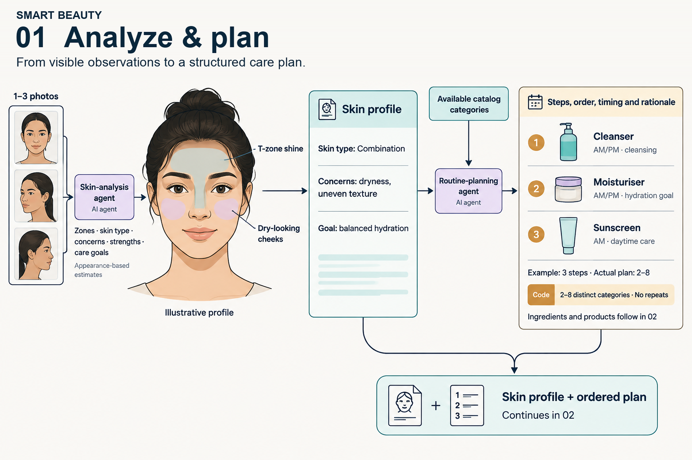
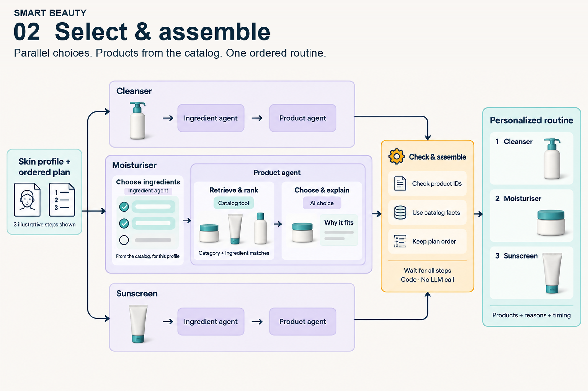

# Guidance for AI-Powered Skincare Analysis on AWS

## Table of Contents

1. [Overview](#overview)
    - [How it works](#how-it-works)
    - [Architecture](#architecture)
    - [Cost](#cost)
2. [Prerequisites](#prerequisites)
    - [Operating System](#operating-system)
    - [Third-party Tools](#third-party-tools)
    - [AWS Account Requirements](#aws-account-requirements)
    - [Supported Regions](#supported-regions)
3. [Deployment Steps](#deployment-steps)
4. [Deployment Validation](#deployment-validation)
5. [Running the Guidance](#running-the-guidance)
6. [Next Steps](#next-steps)
7. [Cleanup](#cleanup)
8. [FAQ, Known Issues, Additional Considerations, and Limitations](#faq-known-issues-additional-considerations-and-limitations)
9. [Revisions](#revisions)
10. [Notices](#notices)
11. [Authors](#authors)

## Overview

This Guidance demonstrates how to build a personalized skincare analysis application using a multi-agent AI architecture on AWS. A user submits up to three skin photos through a secure web interface. Specialized AI agents analyze the photos and plan a routine; server code selects products from the catalog while the application streams progress to the user.

The multi-agent system is orchestrated as a directed graph using the [Strands Agents SDK](https://github.com/strands-agents/sdk-python) and runs on Amazon Bedrock AgentCore Runtime. Specialized agents handle skin analysis, routine planning, ingredient selection, and explanations. Exact ingredient matching uses a private OpenSearch index, with DynamoDB as the authoritative catalog. Progress and intermediate results stream to the frontend via Server-Sent Events (SSE).

### How it works

#### 1. Analyze and plan

The skin-analysis agent turns the photos into a structured skin profile. The planning agent uses that profile and the available catalog categories to choose 2–8 distinct routine steps, including their order, timing, and rationale.



**The skin profile, ordered plan and explicit user constraints carry forward into product selection.**

#### 2. Select and assemble

Each planned step runs an ingredient agent, deterministic product selection, and a product explanation agent. These step-specific chains run in parallel. Bounded catalog discovery informs ingredient selection. Server code ranks exact ingredient counts, enforces explicit must-haves and exclusions, validates canonical facts, and selects up to three products. The product agent explains that approved list.



The illustrations are retained from the original workflow and use a fictional profile and three example steps. The exact-search implementation adds server-owned selection, explicit no-match outcomes and bounded canonical reads. The product agent cannot choose or reorder the approved products.

After all steps finish, deterministic code rechecks canonical records and assembles the routine in its planned order without another model call. Agent-written explanations remain generated text. See the [architecture guide](docs/architecture.md) for the implemented request path, streaming contract, and qualification limits.

### Architecture


[View the reference architecture at full resolution](assets/images/architecture.png).

The reference image is retained unchanged. Private indexed search and its publication pipeline extend that architecture; the numbered description below includes those changes.

1. **Web application.** The user signs in and submits up to three skin photos and optional ingredient constraints. **Amazon CloudFront** serves the React application from a private **Amazon S3** bucket, with **AWS WAF** protecting the web and API paths.
2. **Authentication.** **Amazon Cognito** authenticates administrator-created users. **Amazon API Gateway** validates the Cognito ID token on each analysis request.
3. **Controlled runtime access.** API Gateway invokes a streaming **AWS Lambda** proxy. The proxy checks the authenticated identity, enforces per-user usage limits and active-analysis leases in **Amazon DynamoDB**, and invokes **Amazon Bedrock AgentCore Runtime** with IAM credentials.
4. **Analysis and planning.** AgentCore runs the agents in isolated sessions. A skin-analysis agent uses an **Amazon Bedrock** multimodal model to produce a structured profile. A planning agent chooses 2–8 routine steps from the available catalog categories.
5. **Product selection.** Each step selects exact ingredient IDs, queries private **Amazon OpenSearch Service**, and validates candidates against canonical DynamoDB records. Models explain the server-approved products. **Amazon Bedrock Guardrails** screen model calls. Separate catalog workers publish, reconcile and maintain the index.
6. **Build and monitoring.** **AWS CodeBuild** builds the agent image from source in S3 and pushes it to **Amazon ECR** for the runtime. **Amazon CloudWatch** supports API, WAF, build, runtime and catalog observability.
7. **Assembly and streaming.** Code revalidates selected products and assembles the routine in its planned order, including explicit no-match steps. Progress and results stream back as SSE through Lambda, API Gateway, and CloudFront to the browser.

The [architecture guide](docs/architecture.md) explains the Lambda proxy, usage limits, streaming contract, private search and publication boundaries in more detail.

### Cost

The previous $74/month estimate predates indexed search and is no longer a valid
estimate for this configuration. Provisioned OpenSearch, private VPC endpoints,
publication workers, additional DynamoDB reads/writes and storage add fixed and
usage costs. The default topology uses two search nodes and two Availability Zones;
it has not been qualified at the specification's traffic target.

Before deploying, estimate the selected Region and instance sizes with the
[AWS Pricing Calculator](https://calculator.aws/). Include model calls, AgentCore,
the proxy, search, seven interface endpoints in each of two subnets, catalog
publication/storage, logs and rebuilds. The [acceptance targets](docs/search-spec/acceptance-targets.yaml)
require explicit monthly and per-1,000-routine cost ceilings before production qualification.

## Prerequisites

### Operating System

These deployment instructions are optimized for **macOS** or **Amazon Linux 2023 / Ubuntu 22.04+**. Deployment on Windows requires WSL2 (Windows Subsystem for Linux).

### Third-party Tools

| Tool | Minimum Version | Purpose | Installation |
| --- | --- | --- | --- |
| Node.js | 24.x (LTS) | Frontend build toolchain | [nodejs.org](https://nodejs.org/) |
| Python | 3.12 | Agent runtime and utilities | [python.org](https://www.python.org/downloads/) |
| uv | Latest | Python package manager | [docs.astral.sh/uv](https://docs.astral.sh/uv/getting-started/installation/) |
| Terraform | 1.5 | Infrastructure provisioning | [hashicorp.com](https://developer.hashicorp.com/terraform/downloads) |
| AWS CLI | 2.x | AWS service interaction | [aws.amazon.com/cli](https://aws.amazon.com/cli/) |

### AWS Account Requirements

- An AWS account with permissions to create and manage: IAM roles/policies, Amazon Bedrock, Amazon Bedrock AgentCore, Amazon DynamoDB, Amazon S3, Amazon CloudFront, AWS WAF, Amazon Cognito, Amazon API Gateway, Amazon ECR, AWS CodeBuild, Amazon OpenSearch Service, Lambda, VPC endpoints, and EventBridge.
- Amazon Bedrock model access enabled for the following models in your deployment region:
    - **Anthropic Claude Sonnet 4.6** (cross-region inference profile: `global.anthropic.claude-sonnet-4-6`)
    - **Anthropic Claude Haiku 4.5** (cross-region inference profile: `global.anthropic.claude-haiku-4-5-20251001-v1:0`)

  Enable model access in the [Amazon Bedrock console — Model access](https://console.aws.amazon.com/bedrock/home#/modelaccess).

### Supported Regions

This Guidance uses Amazon Bedrock cross-region inference and must be deployed in one of the following regions:

| Region | Region Code |
| --- | --- |
| US East (N. Virginia) | `us-east-1` **(default)** |
| US West (Oregon) | `us-west-2` |
| Europe (Ireland) | `eu-west-1` |

## Deployment Steps

### 1. Clone the repository

```bash
git clone https://github.com/aws-solutions-library-samples/guidance-for-smart-beauty-on-aws.git
cd guidance-for-smart-beauty-on-aws
```

### 2. Run initial setup

```bash
make setup
```

This installs the locked Python and npm dependencies and packages the proxy and
catalog worker. It makes no AWS changes. Install the prerequisite tools first.

### 3. Review deployment settings

Review `terraform/env-dev.tfvars` and `data/search-config.json`. The bundled catalog
uses GB/GBP, catalog mode and fictional products with unknown stock. Follow the
[catalog runbook](docs/search-spec/operations.md) for an existing account's OpenSearch
service-linked role, supplier feeds, private connectivity, index rebuild and rollback.
`make deploy` bootstraps the state resources and initializes the shared and environment states.

### 4. Configure AWS credentials

```bash
export AWS_PROFILE=your-profile
# or set credentials directly:
export AWS_ACCESS_KEY_ID=<your-access-key>
export AWS_SECRET_ACCESS_KEY=<your-secret-key>
export AWS_REGION=us-east-1

# Verify access
aws sts get-caller-identity
```

### 5. Deploy the full stack

```bash
make deploy
```

Or target a specific environment:

```bash
make deploy ENV=staging
```

The deployment will:
1. Validate all prerequisites (Node.js, Terraform, AWS CLI, uv, active credentials)
2. Provision infrastructure via Terraform, including private OpenSearch, canonical/outbox/metadata tables, publication workers, and the existing application services
3. Build and push the AgentCore container image via AWS CodeBuild
4. Initialize the ingredient registry and exact index, transactionally publish the demo into an empty catalog, and wait for a healthy caught-up index
5. Build the React frontend and deploy to S3 with CloudFront cache invalidation

### 6. Create a user

```bash
make create-user EMAIL=user@example.com
```

The user will receive a temporary password and must set a new password on first login.

## Deployment Validation

After deployment completes, validate with the following steps:

1. **Verify Terraform outputs:**
    ```bash
    cd terraform && terraform output
    ```
    Confirm the following outputs are present: `app_url`, `api_url`, `cognito_user_pool_id`, `catalog_admin_function_name`.

2. **Verify the CloudFront distribution is active:**
    ```bash
    aws cloudfront list-distributions \
      --query "DistributionList.Items[?Comment=='smart-beauty'].{Id:Id,Status:Status,Domain:DomainName}" \
      --output table
    ```
    The status should show `Deployed`.

3. **Verify the AgentCore Runtime endpoint:**
    ```bash
    cd terraform && terraform output -raw agentcore_runtime_arn
    ```

4. **Access the application:** Open the CloudFront URL in a browser — you should see the login page.

## Running the Guidance

1. Open the CloudFront URL (from `terraform output app_url`) in a modern browser (Chrome, Firefox, Safari, or Edge).
2. Sign in with the Cognito user created during deployment. On first login, you will be prompted to set a permanent password.
3. Click **Start Analysis** to begin the skincare analysis flow.
4. Grant camera access when prompted and position your face within the on-screen guide overlay.
5. The camera captures your photo automatically (with countdown timer and flash effect).
6. Observe real-time streaming progress as the AI agents process your skin:
    - **Skin Analysis** — Identifies skin type (oily, dry, combination, sensitive, normal) and specific concerns
    - **Step Planning** — Determines 2–8 routine steps based on the analysis
    - **Ingredient Evaluation** — Selects exact registered ingredient identities for each step
    - **Product Matching** — Ranks exact ingredient counts, enforces explicit must-haves/exclusions, and returns up to three products per step
7. Review product match counts, availability facts and any no-match steps. Optional preferences let you set exact exclusions, category must-haves and a per-product price cap before analysis.

### Expected Output

A complete analysis produces:
- A structured multi-step skincare routine (morning and/or evening)
- Up to three products per step with exact match counts, or a completed no-match result. Counts do not establish ingredient effectiveness.

See the [search specification](docs/search-spec/README.md), [implementation evidence](docs/search-spec/implementation.md) and [operations runbook](docs/search-spec/operations.md). One million products and 20 routines/second remain deployment qualification targets.

## Next Steps

- **Integrate your own product catalog** — Follow the [supplier publication contract](docs/search-spec/operations.md). Use stable product IDs, ordered revisions and a reviewed ingredient registry. Publish JSONL feeds through the canonical/outbox transaction.
- **Tune AI models** — Update `config.py` to select different Amazon Bedrock models (e.g., Amazon Nova Pro for cost optimization or Claude Opus for enhanced analysis depth).
- **Add a custom domain** — Attach a custom domain with an ACM certificate by configuring `terraform/env-dev.tfvars`.
- **Deploy multiple environments** — Use the `ENV` parameter (`dev`, `staging`, `prod`) to run isolated parallel environments with separate Terraform state.
- **Customize content guardrails** — Adjust Amazon Bedrock Guardrails in `terraform/bedrock_guardrails.tf` to modify content filtering policies, PII redaction rules, and topic restrictions.

## Cleanup

Remove all deployed AWS resources:

```bash
make destroy
```

This command will:
- Remove environment resources according to the selected environment's force-destroy settings
- Destroy the selected environment, including private search indices, catalog/outbox/metadata tables, application services and networking. Shared resources and remote state remain.

**Manual cleanup required:** The Terraform remote state resources are not destroyed automatically. Remove them manually if no longer needed:

```bash
ACCOUNT_ID=$(aws sts get-caller-identity --query Account --output text)
aws s3 rb s3://smart-beauty-tfstate-${ACCOUNT_ID} --force
aws dynamodb delete-table --table-name smart-beauty-tfstate-lock --region us-east-1
```

## FAQ, Known Issues, Additional Considerations, and Limitations

**Q: Deployment fails at the CodeBuild step.**
A: Verify that your AWS account has CodeBuild service permissions and that the ECR repository was created. Check the CodeBuild project logs in the CloudWatch console for detailed error output.

**Q: I receive "model access not available" errors at runtime.**
A: Enable both Claude Sonnet 4.6 and Claude Haiku 4.5 in the [Amazon Bedrock Model Access console](https://console.aws.amazon.com/bedrock/home#/modelaccess) for your deployment region. Model access approval can take a few minutes.

**Q: The browser camera does not activate.**
A: Camera access requires a secure context (HTTPS). CloudFront serves over HTTPS by default. If testing locally, use `localhost` (not a bare IP address).

**Q: The Terraform state bucket already exists.**
A: `make bootstrap` checks for existing state resources. `make setup` only installs local dependencies.

**Known limitations:**

- Photos are processed in-memory only and are never persisted to storage. Re-analysis requires capturing a new photo.
- The included product catalog contains 48 synthetic products with fictional brand names for demonstration purposes. Replace with real product data for production use.
- The configured private subnet/AZ allowlist supports `us-east-1`, `us-west-2` and `eu-west-1`; verify model access and service quotas in the chosen account.
- Self-registration is disabled by design. Users must be created by an administrator via `make create-user` or the Cognito console.

**Additional considerations:**

- This Guidance creates an Amazon CloudFront distribution that serves content over the public internet.
- Provisioned search nodes and private endpoints incur costs while idle; model calls and other usage add to them.
- The AgentCore container image is built via CodeBuild on each deployment. Subsequent deployments only rebuild if source code has changed.

For feedback, questions, or suggestions, please use the [Issues](https://github.com/aws-solutions-library-samples/guidance-for-smart-beauty-on-aws/issues) tab in this repository.

## Revisions

| Date | Description |
| --- | --- |
| June 2026 | Initial release |

## Notices

*Customers are responsible for making their own independent assessment of the information in this Guidance. This Guidance: (a) is for informational purposes only, (b) represents AWS current product offerings and practices, which are subject to change without notice, and (c) does not create any commitments or assurances from AWS and its affiliates, suppliers or licensors. AWS products or services are provided "as is" without warranties, representations, or conditions of any kind, whether express or implied. AWS responsibilities and liabilities to its customers are controlled by AWS agreements, and this Guidance is not part of, nor does it modify, any agreement between AWS and its customers.*

## Authors

- **Rania Khemiri** — Prototyping Architect
- **Sophie Manuella Siake Tchouamou** — Delivery Consultant
