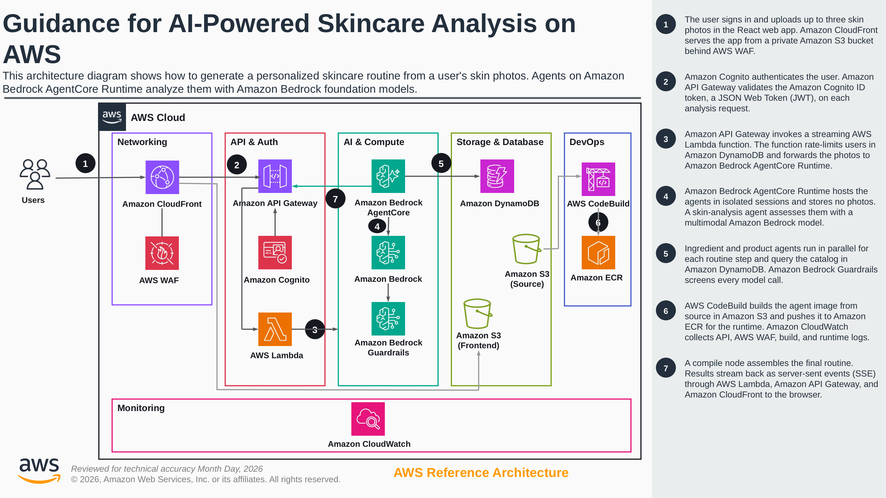

# Architecture

[View the reference architecture at full resolution](architecture.png)

This image is the unchanged export of the approved reference-architecture PPTX. The application has one authenticated analysis endpoint and one streaming result path through a Lambda proxy. The flow below expands on the diagram's seven numbered steps. Background job polling, PDF services, translation agents, and federated sign-in are not included.

## Request flow

1. The React app signs in an administrator-created Cognito user and captures or uploads three photos.
2. CloudFront serves the app from S3 and routes `/api/analyze` through WAF and API Gateway.
3. API Gateway validates the Cognito token. The Lambda streaming proxy checks verified authorizer claims, acquires a per-user allowance and active-analysis lease in DynamoDB, creates a server-owned session ID, and invokes AgentCore with IAM credentials.
4. `agentcore_entrypoint.py` validates the payload and normalizes 1–3 images, each no more than 1 MiB or 2048 pixels per side. The request's `job_id` is a log correlation value, not a stored job.
5. `agents/orchestrator.py` streams the two-phase graph. The entrypoint serializes graph events into the AgentCore SSE transport.
6. The frontend validates incoming data once, updates progress, and displays a typed compiled routine only after successful completion.

## Agent workflow

The diagnose graph runs `skin_analysis` followed by `step_analysis`. Its output is a validated plan with 2–8 unique steps, matching summary counts, supported timing values, and categories present in `data/catalog.yaml`. Skin metrics are constrained to 0–100.

For each planned step, the prescribe graph runs an ingredients agent followed by a products agent. Those chains run concurrently and converge on `CompileNode` after their dependencies complete. Compilation is deterministic: it reuses validated output models in plan order and makes no additional LLM request.

Agent tools query `ProductService` in `agents/product_repository.py`. Queries consume all pages before ingredient aggregation or ranking. Product ranking uses the earliest matching ingredient positions, weighted by `1 / (position + 1)`.

Each product recommendation must reference a stable ID returned by the current step's successful query. Catalog binding restores trusted product fields and restricts image paths before intermediate and final results are emitted. Both model clients apply the configured guardrail with typed block handling.

Category-wide pagination and scoring are the current demo baseline. They have not been validated at large catalog sizes or production throughput; the search specification describes proposed replacement and evaluation work.

Empty data is distinct from a failed database request. Lookup failures propagate and remain recorded per step until a successful retry clears them. Missing, mismatched, empty, or unresolved failed outputs prevent successful compilation.

## Stream contract

| Graph event | Meaning |
|---|---|
| `multiagent_node_start` | A named node has started. |
| `multiagent_node_stop` | A node completed, with status and structured output when applicable. |
| `multiagent_result` | A graph finished. The diagnose result is intermediate; completion requires the compiled routine. |
| `error` | The pipeline failed; an allowlisted code, safe message, and correlation reference are returned. |

The API client supports SSE comments, CRLF, multiline data, split UTF-8 chunks and AgentCore's JSON-string encoding. It rejects malformed data, unsuccessful node/graph statuses and streams that end without a final routine. A transport or pipeline error never becomes an empty success object.

`frontend/src/hooks/useAnalysis.ts` owns the request and all analysis state. Reset, sign-out and unmount abort the active request and invalidate stale callbacks. Components receive canonical types from `frontend/src/types/index.ts`; they do not parse JSON or infer stages from prose. Final empty recommendations have explicit messages instead of loading skeletons.

## Infrastructure and builds

| Area | Responsibility |
|---|---|
| CloudFront, S3 and WAF | Frontend delivery and the protected API origin path. |
| Cognito | Direct SRP/password/refresh authentication for administrator-created users. |
| API Gateway | Cognito authorization, streaming integration, and CORS responses. |
| Lambda proxy | Verified user identity, usage limits, server-owned sessions, and IAM-authenticated runtime invocation. |
| AgentCore and Bedrock | Runtime hosting, graph execution and model calls. |
| DynamoDB | Product catalog/category index and a separate per-user usage/lease table. |
| S3, CodeBuild and ECR | Source archive, ARM64 image build and immutable image publication. |
| CloudWatch | Runtime, build and API observability. |

`terraform/shared/` owns account-level API Gateway logging configuration. Each application environment has its own state key. Deployment resolves the region once and passes it to provisioning and migration.

A shared source-file manifest controls runtime packaging and change detection. It includes the catalog and Python lockfile. Image tags follow the complete content hash. Archives are recreated so deleted files cannot survive in subsequent builds. API stage deployment similarly tracks configuration content, including integration and OPTIONS response settings.

The runtime image installs locked dependencies using uv and runs as a non-root user. Python and npm locks are tracked; local test dependencies are separate from the runtime instrumentation group.

## Network and authentication details

The diagram groups services by responsibility. Its AWS Cloud outline is not a
VPC or single-region boundary. Deployment and authentication settings are
described below.

CloudFront and its WAF are global edge services. The frontend S3 bucket is
regional and private; CloudFront accesses it through OAC / SigV4. API requests
are uncached, and a CloudFront Function rewrites `/api/analyze` for the regional
API origin. Regional WAF checks a custom origin-verification header.

AgentCore is configured with `network_mode = "PUBLIC"`. This selects its
network configuration rather than disabling authentication. VPC mode provides
connectivity to private resources; private inbound access through PrivateLink
is a separate configuration. The runtime uses IAM authentication. Its resource policy allows the Lambda proxy
role and explicitly denies invocation by other principals. Browser Cognito tokens
are verified at API Gateway, rather than forwarded as runtime authentication.
Normal gateway access and direct-runtime rejection still require live deployment
verification; source configuration and offline policy assertions are not proof of
enforcement in AWS.

The default limits allow five accepted analyses per user per fixed UTC hour and
one active analysis per user, with ten concurrent proxy invocations per deployment.
DynamoDB transactions coordinate counters and leases. Ambiguous runtime failures
retain the lease until expiry because disconnecting does not prove runtime work
has stopped. These controls bound accepted usage; they do not establish production
throughput.

The default Bedrock model IDs use global inference profiles. Model processing
can occur outside the deployment region. CloudFront access logs go to S3; API, WAF and build logs go to
CloudWatch. Runtime telemetry is instrumented but its delivery has not been
verified live.

## Verification and limits

See [the testing guide](../tests/README.md) for unit, offline integration, frontend, and live smoke layers. Offline integration exercises the real AgentCore HTTP/SSE adapter with external work substituted; deployment tests use command stubs and temporary files.

Live behavior still depends on model access, regional availability, quotas, IAM and network timeouts. In particular, the configured CloudFront read timeout is 60 seconds between upstream responses. There is no persisted recovery path after disconnecting.

Guardrails are connected to both model clients. Regional WAF managed blocking
rules run before the origin-header allow rule, and sensitive headers are redacted
from WAF logs. Remaining live verification and deployment decisions are tracked
in [the security checklist](security-checklist.md), including the default
CloudFront certificate's TLS policy and historical credential exposure.

## Diagram maintenance

The source of truth is
`guidance-for-ai-powered-skincare-analysis-on-aws.pptx`, retained with the
Guidance publishing artefacts. Its existing PNG export is copied unchanged to
`assets/images/architecture.png` for the README and `docs/architecture.png` for
this guide. Both copies must stay identical. The slide has not been redrawn,
relabelled, cropped, or generated with an image model.

The older [draw.io diagram](architecture.drawio) is retained only as historical
source. It predates the Lambda proxy and is not the editable source of the
approved reference architecture. Future architecture revisions should update
the PPTX through the Guidance review process and replace both PNG copies with
the approved export.

## Reference documentation

- [AWS architecture icons](https://aws.amazon.com/architecture/icons/)
- [CloudFront OAC and private S3 access](https://docs.aws.amazon.com/AmazonCloudFront/latest/DeveloperGuide/private-content-restricting-access-to-s3.html)
- [AWS WAF resource scope](https://docs.aws.amazon.com/waf/latest/developerguide/how-aws-waf-works-resources.html)
- [AgentCore VPC networking](https://docs.aws.amazon.com/bedrock-agentcore/latest/devguide/agentcore-vpc.html)
- [AgentCore JWT authentication](https://docs.aws.amazon.com/bedrock-agentcore/latest/devguide/inbound-jwt-authorizer.html)
- [AgentCore runtime security](https://docs.aws.amazon.com/bedrock-agentcore/latest/devguide/runtime-security-best-practices.html)
- [Strands structured output](https://strandsagents.com/docs/user-guide/concepts/agents/structured-output)
- [AgentCore Python SDK](https://github.com/aws/bedrock-agentcore-sdk-python)
- [DynamoDB query pagination](https://docs.aws.amazon.com/amazondynamodb/latest/developerguide/Query.Pagination.html)
- [React effect cleanup](https://react.dev/learn/synchronizing-with-effects)
- [uv project locking](https://docs.astral.sh/uv/concepts/projects/sync/)
- [npm clean installs](https://docs.npmjs.com/cli/v11/commands/npm-ci)
